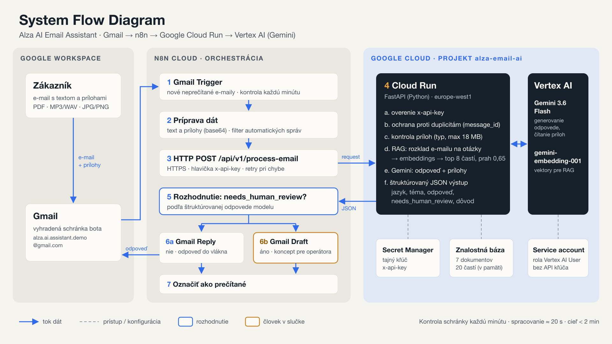

# Alza AI Email Assistant

E-mailový asistent pre zákaznícku podporu: prečíta prichádzajúci e-mail vrátane príloh (PDF, audio, obrázky), vyhľadá odpoveď v znalostnej báze a odpovie v pôvodnom vlákne. Ak si nie je istý, nič neodošle a pripraví koncept pre operátora.

**Gmail → n8n → Google Cloud Run (FastAPI) → Vertex AI (Gemini 3.6 Flash)** · Advanced feature: **Option B – RAG**



---

## Vyskúšajte

| | |
|---|---|
| E-mail bota | `alza.ai.assistant.demo@gmail.com` |
| Stav služby | https://alza-email-assistant-167006032813.europe-west1.run.app/health |
| Dokumentácia API | https://alza-email-assistant-167006032813.europe-west1.run.app/docs |

Príklad: *„Koľko stojí doručenie dronom, keď mám AlzaPlus+?"* alebo otázka s fotkou, PDF faktúrou či hlasovou správou. Odpoveď príde do toho istého vlákna, v testoch v priemere do 1 minúty.

---

## Ako to funguje

| Krok | Kde | Čo sa deje |
|---|---|---|
| 1 | n8n | Gmail Trigger každú minútu načíta nové neprečítané e-maily |
| 2 | n8n | Príprava dát: text, odosielateľ, vlákno, prílohy (base64); automatické správy sa preskočia |
| 3 | n8n | `POST /api/v1/process-email` cez HTTPS s hlavičkou `x-api-key` |
| 4 | Cloud Run | Overenie kľúča, ochrana proti duplicitám, kontrola príloh, RAG, volanie Gemini, štruktúrovaný JSON |
| 5 | n8n | Rozhodnutie podľa `needs_human_review` |
| 6a / 6b | n8n | Odpoveď do pôvodného vlákna / koncept pre operátora |
| 7 | n8n | E-mail sa označí ako prečítaný |

Model vracia štruktúrovaný výstup (`language`, `intent`, `reply`, `attachments_summary`, `needs_human_review`, `review_reason`), takže rozhodnutie „odoslať alebo koncept" je dátové pole, nie odhad z textu.

---

## Technológie

| Vrstva | Technológia | Dôvod |
|---|---|---|
| Orchestrácia | n8n Cloud | Napojenie na Gmail (OAuth, vlákna, prílohy) a vizuálny audit každého behu |
| AI služba | Python 3.12, FastAPI, Pydantic | Testovateľná a merateľná AI logika |
| Hosting | Google Cloud Run (`europe-west1`) | Serverless kontajner, škáluje na nulu |
| Model | Gemini 3.6 Flash cez Vertex AI | Natívne multimodálny: text, PDF, obrázky aj audio v jednom volaní |
| Embeddings | `gemini-embedding-001` | Vektory pre vyhľadávanie v znalostnej báze |
| Tajomstvá a prístup | Secret Manager, service account | Žiadne kľúče v kóde, Vertex AI bez API kľúča |

---

## RAG (Option B)

- **Znalostná báza:** 7 dokumentov o fiktívnych službách a podmienkach Alzy (Alza Drone Delivery, Instant Swap, AlzaPlus+ VIP, Alza Care+, AlzaPay Later, doprava a AlzaBox, vrátenie tovaru, záruka) v `app/rag/documents/`. Všetky služby, ceny a podmienky sú vymyslené pre demo.
- **Indexovanie:** dokumenty sa delia podľa nadpisov na 20 častí, embeddingy sa vypočítajú jedným dávkovým volaním pri štarte služby.
- **Vyhľadávanie:** kosínová podobnosť, top 8 častí, prah 0,65 (kalibrovaný na nameraných skóre).
- **Rozklad dotazu:** e-mail sa rozdelí na jednotlivé otázky a každá dostane vlastný kontext, všetko v jednom volaní.
- **Odolnosť:** ak by embeddingy neboli dostupné, služba prejde na vyhľadávanie podľa kľúčových slov.
- **Pravidlo pre model:** fakty len zo znalostnej bázy. Keď informácia chýba, model to povie a e-mail ide na kontrolu človekom.

---

## Bezpečnosť a spoľahlivosť

- **Autentifikácia:** každá požiadavka z n8n nesie tajný kľúč `x-api-key` (Secret Manager); bez neho `401`.
- **Human-in-the-loop:** pri chýbajúcich faktoch, sťažnosti, žiadosti o peniaze, pokuse o manipuláciu alebo nečitateľnej prílohe vznikne len koncept.
- **Ochrana pred prompt injection:** obsah e-mailu je v prompte oddelený ako dáta zákazníka.
- **Žiadne náhradné šablóny:** keď model nie je dostupný, služba vráti `503` a zákazníkovi nič neodíde.
- **Idempotencia:** opakovaná požiadavka s rovnakým `message_id` dostane už hotovú odpoveď.
- **Validácia príloh:** podporované MIME typy, limit 18 MB na e-mail, escapovanie HTML odpovede.

---

## Kvalita (eval na Vertex AI)

| Meranie | Výsledok |
|---|---|
| RAG vyhľadávanie (24 otázok vrátane otázok mimo znalostnej bázy a viacotázkových e-mailov) | **23/24** |
| End-to-end odpovede (fakty, CZ/SK, manipulácia, sťažnosť, oslovenie) | **19/19** |
| z toho prílohy: PDF, MP3, WAV, JPG, PNG a kombinácia troch príloh | **6/6** |
| Spracovanie jedného e-mailu | priemer **20,6 s** |
| Cez Gmail a n8n, od prijatia po odpoveď (10 e-mailov) | priemer **58 s**, max **83 s** |

Pri prílohách test overuje, že odpoveď obsahuje údaj, ktorý je len v prílohe (číslo faktúry z PDF, obsah hlasovej správy, sériové číslo z fotky). Testovacie prípady sú v `evals/`, prílohy v `evals/fixtures/`.

---

## Štruktúra repozitára

```
app/
  main.py                  FastAPI aplikácia, autentifikácia, spracovanie e-mailu
  config.py                konfigurácia z premenných prostredia
  idempotency.py           ochrana proti dvojitému spracovaniu
  models/schemas.py        vstupné a výstupné schémy, validácia príloh
  services/gemini_service.py  prompt, volanie Gemini, embeddings
  rag/knowledge_base.py    chunkovanie, index, vyhľadávanie, rozklad dotazu
  rag/documents/           znalostná báza (7 fiktívnych dokumentov)
n8n/workflow_alza_assistant.json   workflow na import do n8n
evals/                     eval sady a testovacie prílohy
scripts/run_evals.py       eval proti skutočnému modelu
scripts/smoke_test.py      test nasadenej služby s reálnymi prílohami
tests/                     unit testy (bez cloudu)
docs/                      System Flow Diagram (PNG, SVG)
Dockerfile
```

---

## Lokálne spustenie

```bash
python3.12 -m venv .venv && source .venv/bin/activate
pip install -r requirements-dev.txt
cp .env.example .env        # doplňte GEMINI_API_KEY a N8N_API_KEY
uvicorn app.main:app --reload --port 8000
```

Swagger: `http://localhost:8000/docs`

**Testy** (bez cloudu, model je nahradený falošným):
```bash
pytest tests/
```

**Eval proti skutočnému modelu:**
```bash
N8N_API_KEY=x GOOGLE_CLOUD_PROJECT=<projekt> python scripts/run_evals.py --gcloud-token --delay 5
```

**Test nasadenej služby s prílohami:**
```bash
python scripts/smoke_test.py --url <SERVICE_URL> --key <N8N_API_KEY> evals/fixtures/faktura.pdf evals/fixtures/hlasova_sprava.mp3
```

---

## Nasadenie na Google Cloud Run

```bash
export PROJECT_ID=<projekt> REGION=europe-west1
gcloud services enable run.googleapis.com cloudbuild.googleapis.com artifactregistry.googleapis.com \
  aiplatform.googleapis.com secretmanager.googleapis.com

# Service account s prístupom k Vertex AI
gcloud iam service-accounts create alza-assistant
export SA=alza-assistant@$PROJECT_ID.iam.gserviceaccount.com
gcloud projects add-iam-policy-binding $PROJECT_ID --member=serviceAccount:$SA --role=roles/aiplatform.user

# Tajný kľúč pre n8n
openssl rand -hex 32 | tr -d '\n' | gcloud secrets create n8n-api-key --data-file=-
gcloud secrets add-iam-policy-binding n8n-api-key --member=serviceAccount:$SA --role=roles/secretmanager.secretAccessor

# Deploy
gcloud run deploy alza-email-assistant --source . --region $REGION --service-account $SA \
  --allow-unauthenticated --memory 512Mi --timeout 120 --cpu-boost --max-instances 3 \
  --set-env-vars GOOGLE_GENAI_USE_VERTEXAI=true,GOOGLE_CLOUD_PROJECT=$PROJECT_ID,GOOGLE_CLOUD_LOCATION=global \
  --set-secrets N8N_API_KEY=n8n-api-key:latest
```

`--allow-unauthenticated` je potrebné, lebo n8n Cloud neposiela Google IAM token. Endpoint chráni `x-api-key`. Gemini 3.6 Flash je na Vertex AI dostupný v lokácii `global`.

---

## n8n workflow

1. Importujte `n8n/workflow_alza_assistant.json` (Import from File).
2. V Gmail uzloch (Trigger, Reply, Draft, Mark as Read) vyberte Gmail OAuth2 credential schránky bota.
3. V uzle HTTP Request nastavte URL služby (`…/api/v1/process-email`) a credential typu Header Auth: názov `x-api-key`, hodnota z Secret Managera.
4. Aktivujte workflow.

---

## Konfigurácia

| Premenná | Predvolené | Popis |
|---|---|---|
| `N8N_API_KEY` | (povinné) | Tajný kľúč, ktorý posiela n8n v hlavičke `x-api-key` |
| `GOOGLE_GENAI_USE_VERTEXAI` | `false` | `true` = Vertex AI cez service account |
| `GOOGLE_CLOUD_PROJECT` | – | GCP projekt pre Vertex AI |
| `GOOGLE_CLOUD_LOCATION` | `global` | Lokácia modelu |
| `GEMINI_API_KEY` | – | Kľúč pre lokálny vývoj bez Vertex AI |
| `GEMINI_MODEL` | `gemini-3.6-flash` | Generatívny model |
| `EMBEDDING_MODEL` | `gemini-embedding-001` | Model pre embeddings |
| `GEMINI_TEMPERATURE` | `0.2` | Konzistentnosť odpovedí |
| `RAG_TOP_K` / `RAG_MIN_SCORE` | `8` / `0.65` | Počet častí a prah podobnosti |
| `MAX_ATTACHMENTS_TOTAL_MB` | `18` | Limit príloh na e-mail |

---

## Ďalší rozvoj

- Gmail push notifikácie cez Pub/Sub namiesto kontroly každú minútu
- Zdieľaná idempotencia naprieč inštanciami (Firestore)
- Celé vlákno cez Gmail Thread API (API už prijíma `conversation_history`)
- Vertex AI Vector Search pri väčšej znalostnej báze
- Eval sada v CI pri každej zmene promptu
